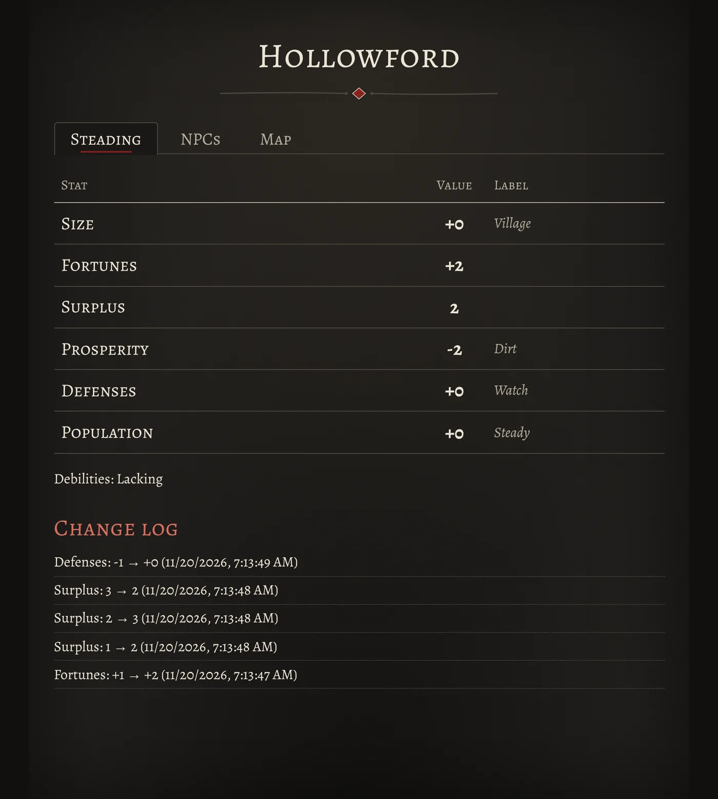
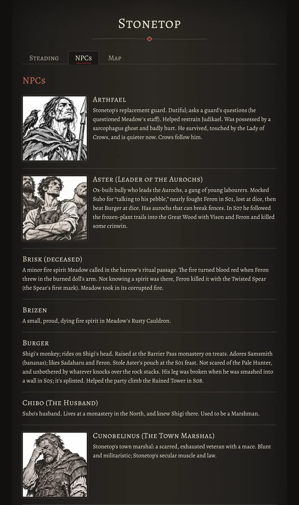
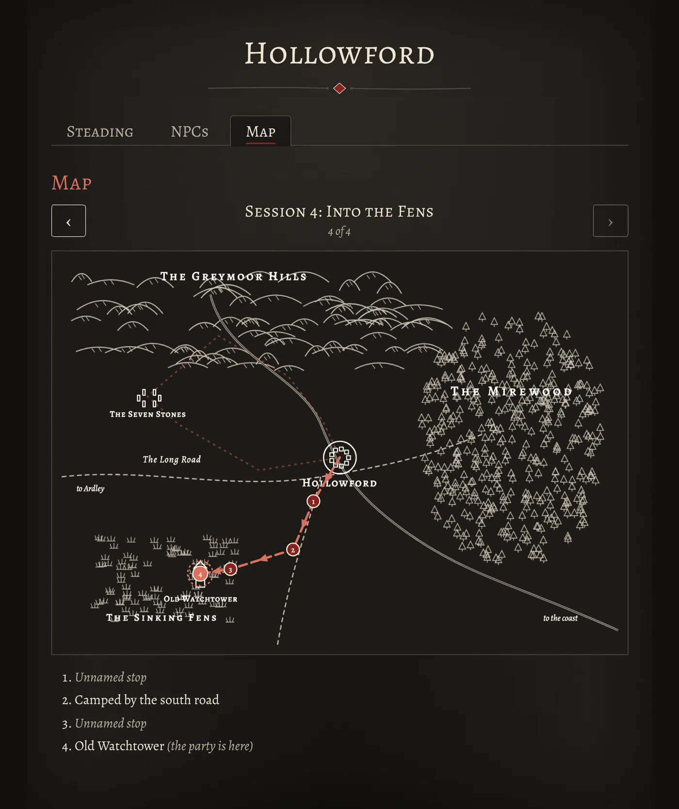
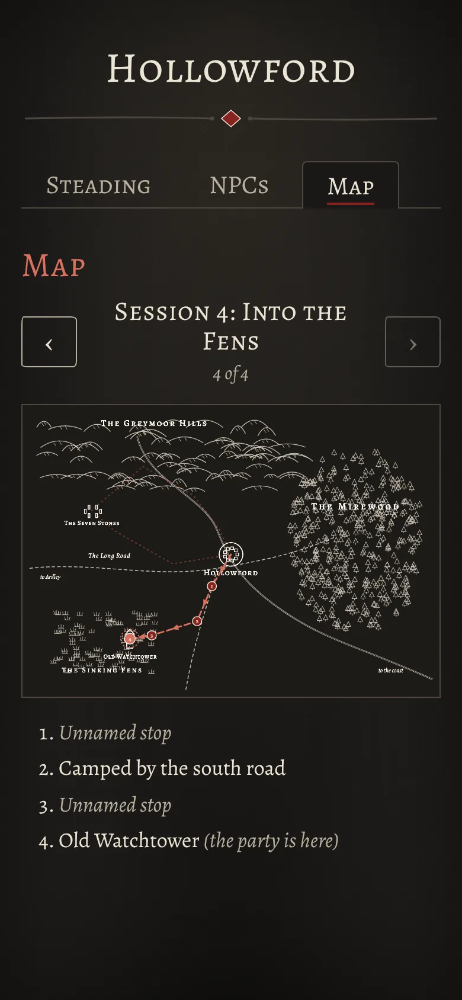
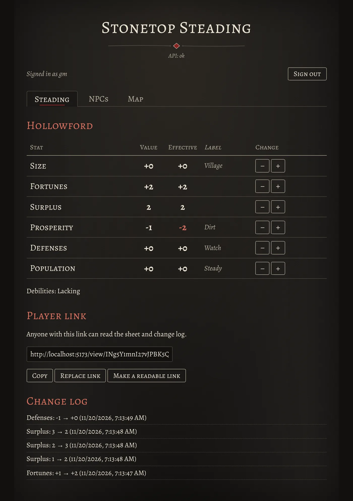
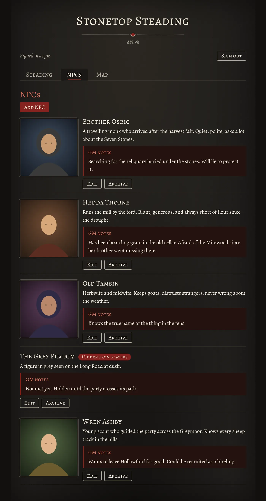
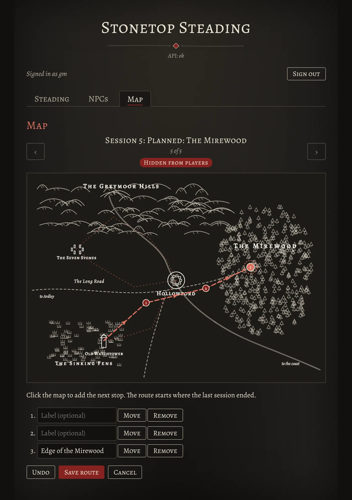

# Stonetop Steading

[](https://github.com/Bnocz/stonetop-steading/actions/workflows/ci.yml)

A web app for running a [Stonetop](#disclaimer) tabletop campaign between sessions. The GM keeps the village (the *steading*), its people and the party's travels up to date; the players open a private, read-only link that shows exactly what their characters would know, and nothing the GM is keeping secret.

**Stack:** ASP.NET Core 10 minimal API · EF Core + PostgreSQL · React 19 + TypeScript + React Query · xUnit + Testcontainers · Vitest · Docker · GitHub Actions → Render + Neon

> The player Steading and NPC screenshots come straight from my campaign's live player link. The map and GM screenshots use a made-up demo steading, *Hollowford*, with an original map drawn for this README: my campaign's map comes from the Stonetop book, and the GM views hold my players' secrets.

## What the players see

Players get a link like `/view/ember-moss-lantern-crow`. There's no account and no sign-in, and it always shows the latest state of the campaign.

| The steading | The people they've met |
| --- | --- |
|  |  |

**The map, session by session.** Arrows step through the sessions. Each one shows that session's route with numbered stops and direction arrows, earlier journeys faded underneath, and a marker where the party is now. It opens on the latest session.

| Desktop | Phone |
| --- | --- |
|  |  |

Notice what's missing: GM notes, an NPC the party hasn't met yet, and a session the GM is still planning. None of it is hidden by the browser; the server never sends it.

## What the GM sees

The GM signs in to edit everything. Secrets are marked clearly so it's obvious what players can't see.

| The steading | NPCs with GM notes | Drawing a route |
| --- | --- | --- |
|  |  |  |

## Features

- **Steading sheet.** Size, Fortunes, Surplus, Prosperity, Defenses and Population, with each stat's range and labels (Village, Poor, Militia…). Debilities change the *effective* value, e.g. Lacking lowers Prosperity, while the raw value is kept.
- **Change log.** Every stat change is recorded, newest first, for the GM and the players.
- **NPCs.** Name, what the party knows, private GM notes, a portrait, and a "Hidden from players" switch. Deleting archives an NPC, so it can be restored.
- **Session map.** Upload a region map, then for each session click the party's route onto it. Sessions start hidden, so the GM can plan ahead.
- **Player link.** A long random link, or a readable four-word one (`ember-moss-lantern-crow`). Replacing it cuts off the old one at once.
- **Built for phones too.** Every page works at phone width without sideways scrolling, in a dark "ink and ember" theme.

## How it's built

```
Browser ── React + React Query ──►  ASP.NET Core minimal API  ──►  PostgreSQL
                                     /api/gm/...      (cookie auth, GM only)
                                     /api/view/{link}/...  (public, read-only)
```

One Docker image: the API serves the built React app from `wwwroot`, so the whole thing is a single free Render web service backed by a free Neon Postgres.

Decisions worth calling out:

- **Secrets are filtered on the server, not hidden in the UI.** Player endpoints query only visible rows and return dedicated player DTOs that list every field on purpose, so a new column can't leak by accident. Tests check the raw JSON players receive, not just the typed objects.
- **The log can't disagree with the sheet.** A stat change and its log entry are written in the same `SaveChanges`, so they commit or fail together. A row version catches two edits racing each other.
- **Raw values in the database, rules in the domain.** Only raw stats are stored; effective values and labels are computed in `src/Api/Domain`, and the database also enforces each stat's range with check constraints.
- **Uploads are checked by content.** The map and portraits must really be PNG, JPEG or WebP, detected from the file's bytes rather than its name. They're stored in Postgres, because Render's disk is wiped on every deploy, and served with ETags. Portraits are shrunk in the browser before upload to keep the database small.
- **Sessions survive restarts.** The GM's 30-day sliding sign-in cookie is signed with ASP.NET Data Protection keys kept in Postgres, so a redeploy or the free tier's sleep doesn't sign anyone out.
- **Unguessable links.** Random links are 256 bits; readable links are four words from a 512-word list (about 68 billion combinations). Player responses are `no-store`, so a replaced link doesn't linger in a browser cache.
- **Sign-in is rate-limited,** and the single GM account's credentials come from environment variables, never the repo.

## Testing and CI

- **API:** about 235 xUnit tests run against a **real PostgreSQL 17** in Docker via Testcontainers. Each test gets its own database, so migrations, constraints and transactions are tested for real, not mocked.
- **Frontend:** about 99 Vitest + Testing Library tests, written against what users see (roles, labels, text) rather than implementation details.
- **Workflow:** tests are written first and must fail before the code exists. Each feature is planned up front and lands as its own small pull request.
- **CI** (`.github/workflows/ci.yml`), on every pull request: API tests; frontend lint, tests and production build; then the Docker image is built and smoke-tested by starting it and hitting `/health` and the home page. Pushes to `main` that pass all of that trigger the Render deploy.

## Project layout

```
src/Api              ASP.NET Core API: endpoints, EF Core, migrations
src/Api/Domain       Steading rules: stat ranges, labels, effective values, uploads
src/web              React + TypeScript app (Vite)
tests/Api.Tests      xUnit + Testcontainers integration tests
docs/screenshots     Images for this README
Dockerfile           Multi-stage: build web → publish API → copy web into wwwroot
```

## Running it locally

You need the .NET 10 SDK, Node 22+ and Docker (for the API tests and a local Postgres).

```bash
docker run -d --name steading-db -e POSTGRES_PASSWORD=dev -p 5432:5432 postgres:17-alpine
```

```bash
cd src/Api
export ConnectionStrings__Default="Host=localhost;Database=steading;Username=postgres;Password=dev"
export Admin__Username=gm
export Admin__Password=choose-a-password
dotnet run
```

```bash
cd src/web && npm ci && npm run dev
```

The API migrates and seeds the database on startup. Open the Vite URL, sign in as the GM, and copy the player link from the Steading tab.

```bash
dotnet test                 # API tests (needs Docker running)
cd src/web && npm test      # frontend tests
docker build -t stonetop-steading .
```

## Disclaimer

Stonetop is a tabletop roleplaying game by Jeremy Strandberg. This is an unofficial fan-made tool for my own table, and isn't affiliated with or endorsed by the game's creator or publisher. It uses only the steading's stat names, ranges and labels; no book text, art or maps are included in this repository.

## License

The code is available under the [MIT License](LICENSE). Stonetop itself, and any game content, belongs to its creator; see the disclaimer above.
